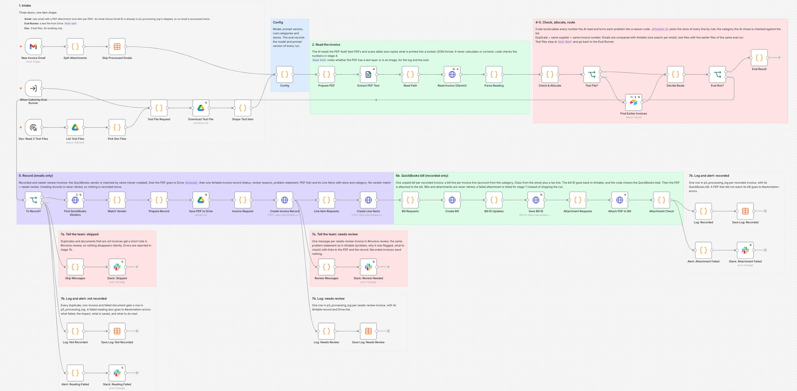
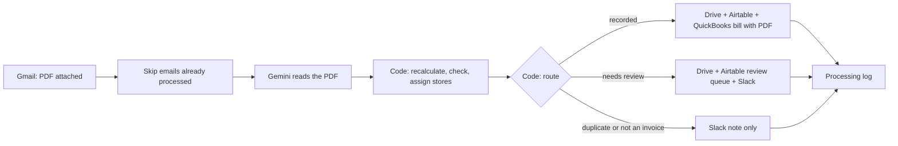
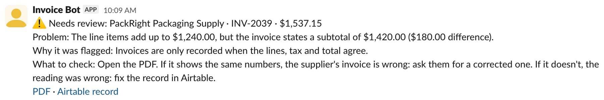
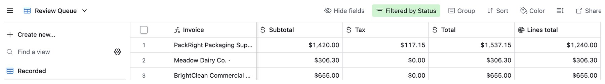
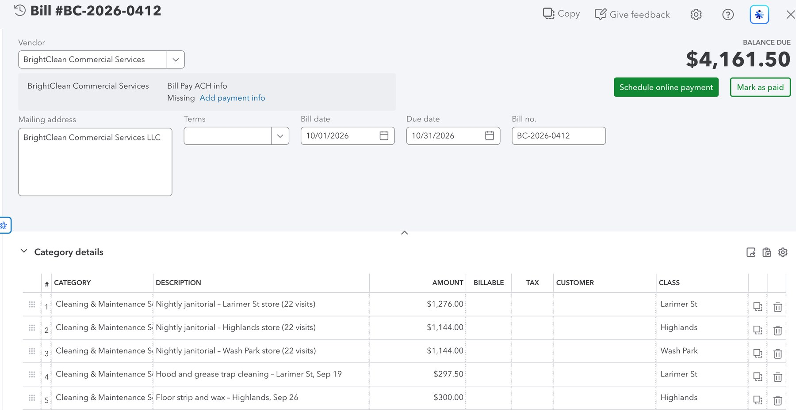
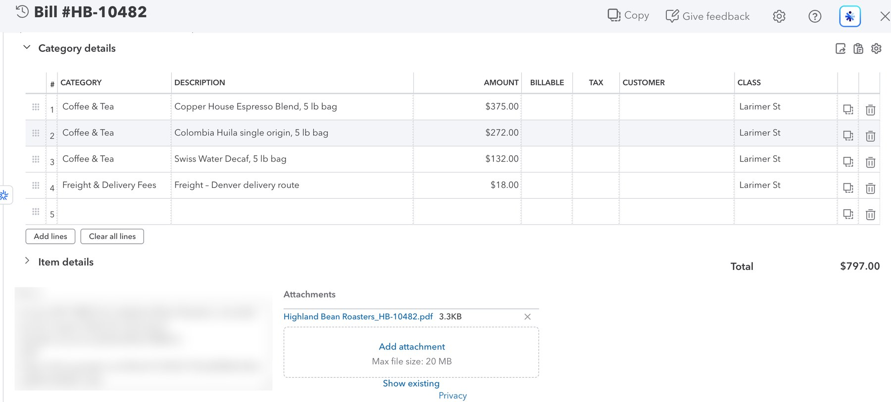
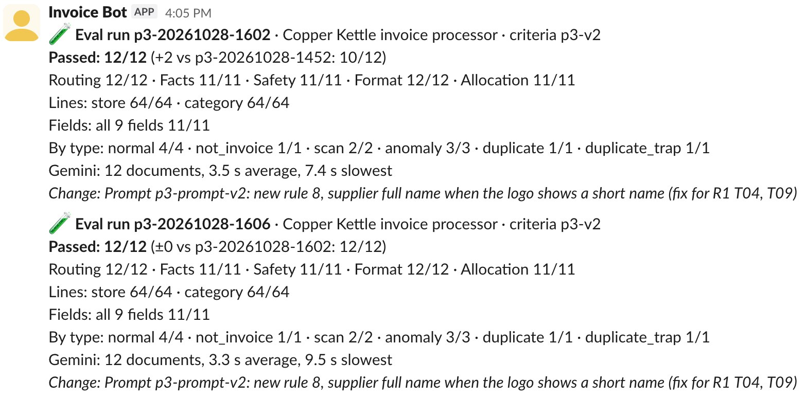

# AI Invoice Processor for Supplier PDFs (n8n)

Reads supplier invoice PDFs that arrive by email, checks every number with code, and records the good ones in QuickBooks as unpaid bills with the original PDF attached. Invoices whose numbers don't add up, or that are missing something important, are not recorded. They wait in an Airtable review queue, and the team gets a Slack message that says what's wrong and what to check. Spending is split by store and cost category, even when one invoice covers several stores. Every change is re-tested on 12 fixed test invoices with an answer key.

> **Demo project.** Built for a fictional café group, *Copper Kettle Café* (three stores in Denver), and tested with made-up suppliers and invoices. No real company data was used. QuickBooks is a sandbox company.



## The problem

A café group gets invoices from its suppliers every week: coffee, milk, cups, cleaning. Someone retypes each one into the accounting system. AI can read invoices, so the retyping can go. But AI only copies what it sees. If a supplier prints a wrong subtotal, or the AI misreads a number, an automation that trusts the AI books the wrong amount, and nobody notices until the books don't match.

So the AI is only allowed to read. Code recalculates every number and decides what happens to the invoice. An invoice reaches QuickBooks only when the lines, the tax and the total agree, the supplier is known, and nothing important is missing.

## What it does

The main workflow handles every PDF attached to an email, from start to finish:

| Stage | What happens |
|---|---|
| 1. Intake | Gmail is checked every minute (`in:inbox has:attachment filename:pdf -from:me`). One item per PDF; other attachments are skipped. Emails that are already in the processing log are skipped, so the same email is never processed twice |
| 2. Read | Code checks whether the PDF has a text layer or is a scan. The PDF goes straight to Gemini with a fixed output schema (temperature 0): is it an invoice, number, supplier, dates, currency, subtotal, tax, total, delivery address, and every line with quantity, unit price, amount and cost category |
| 4. Check and allocate | **Code recalculates everything**: quantity × price for each line, the sum of the lines, subtotal + tax = total, due date after invoice date, no future dates, currency, required fields. Each line gets a store from the delivery address or from the line's own text (`all 3 stores` → Shared). The result is a list of reason codes with the real numbers |
| 5. Duplicates and route | Airtable is searched for the same supplier + invoice number. Code picks one route: `recorded`, `needs_review`, `duplicate` or `not_invoice` |
| 6. Record | The PDF is saved to Google Drive. Recorded and needs-review invoices go to Airtable with their line items. **Recorded invoices only:** the supplier is matched to a QuickBooks vendor by name, a bill is created (one line per invoice line, expense account by category, Class by store, plus a tax line), and the PDF is attached to the bill |
| 7. Report and log | Slack `#invoice-review` gets a message for every invoice that needs review, every duplicate and every document that isn't an invoice. Technical errors go to `#automation-errors`. Every document gets one row in the processing log |

Stage 3 (extracting the data) was merged into stage 2, because Gemini reads the PDF directly.

Three smaller workflows support it:

- **Eval Runner:** runs the 12 test invoices through the real workflow in test mode, scores each one with code, and posts the result to Slack `#eval-runs`.
- **Error Alerts:** if the workflow crashes, the failure is logged and `#automation-errors` gets the step, the error and what to check.
- **Setup Check:** creates the vendors, expense accounts and Classes in QuickBooks, sends a test message to each Slack channel, and checks the answer key.



### Design choices

- **The answer key holds what is printed, not what should be there.** If the subtotal on the PDF is wrong, the AI must copy the wrong number, and code flags it. An AI that quietly "fixes" a number fails the test, because a fixed number hides the supplier's mistake.
- **Code decides, with fixed rules.** Gemini only fills in fields. The route, the reason and the store of every line come from code, so the same invoice always gets the same result, and every decision can be explained.
- **Messages say what to do.** Every Slack message has the problem with real numbers, why it was flagged, and what to check. It is written by code from the reason code, not by AI.
- **A duplicate is the same supplier and the same invoice number.** Two suppliers can use the same number (one test invoice checks exactly that). If the number matches but the amount doesn't, the invoice goes to review instead of being skipped.
- **Nothing that could create a double record is retried.** Reading, searching and uploading are retried. Creating the Airtable record and the QuickBooks bill is not.
- **Vendors are never created automatically.** A supplier that isn't in QuickBooks goes to review, so a misread name can't create a second vendor.
- **Bills are recorded as unpaid.** Paying a supplier stays a person's decision.
- **The bill is created with an HTTP Request**, because n8n's QuickBooks node can't set a Class per line or the bill number.
- **Nothing is lost silently.** A document the AI says isn't an invoice still gets a Slack note with the file name, so a misjudged invoice can be forwarded again.

## What it looks like

An invoice whose lines don't add up to the printed subtotal. It is not recorded, and the team gets this in Slack:



The same invoice in the Airtable review queue, where *Lines total* (summed by Airtable from the line items) shows the difference next to the printed subtotal:



A cleaning invoice for all three stores, recorded in QuickBooks with one line per store (Class) and the expense account for its category:



The original PDF is attached to every bill:



## Testing

A demo with one clean invoice can look fine while the workflow still books wrong numbers. So the workflow is tested on **12 fixed documents** with an answer key ([`evals/test-cases.json`](evals/test-cases.json)), like an exam. The PDFs are in [`test-set/`](test-set):

- 4 normal invoices: a coffee roaster, a dairy, 21 lines over two pages, and a cleaning service for three stores
- 2 scans: an office scan and a tilted phone photo, both without a text layer
- 3 invoices with a problem: a subtotal printed wrong, a due date before the invoice date, an empty invoice number with a PO number right next to it
- 1 invoice sent again with a reminder stamp
- 1 invoice from another supplier with the same invoice number (must **not** be treated as a duplicate)
- 1 price list attached to the same email as an invoice (not an invoice)

The **Eval Runner** sends each document through the real workflow in test mode, which stops before anything is saved (Drive, Airtable, QuickBooks, Slack). Code scores every document in five groups, and one mistake counts in one group only:

- **Routing:** is it an invoice, the route, the reason, and which earlier document it duplicates
- **Facts:** every field and every line (quantity, price, amount)
- **Safety:** nothing invented (an empty field stays empty) and nothing corrected (a number that differs from the PDF but matches the math)
- **Format:** dates, numbers, currency codes, category codes
- **Allocation:** the store of the invoice and the store and category of all 64 lines

There is no AI judge: every answer is an exact value, so code is enough.

| Run | What changed | Passed |
|---|---|---|
| R1 | Baseline, prompt v1 | 10/12 |
| R2 | Prompt v2: one rule for the supplier's full name | **12/12, 12/12** (2 runs) |
| R3 | Check after adding stages 6 and 7 (QuickBooks, Slack, log) | 12/12 |

Criteria version `p3-v2` for all runs, October 28, 2026. In every run, all 64 lines got the right store and the right category.



What the tests caught:

- **A supplier name cut short.** In R1, both cleaning invoices were read as "BrightClean". The logo prints the name on two lines, and the AI copied only the first. The route was still right, but the QuickBooks vendor is "BrightClean Commercial Services", so in real use no bill would have been created. One prompt rule (use the supplier's full legal name) fixed both, and nothing else broke.
- **Emails processed again.** In the final run by email, the Gmail trigger was set to fetch one email per check. After the queue was empty, it kept fetching old emails again, every minute. Invoices with a number were caught as duplicates, but the invoice without a number was recorded twice. Fix: the limit was removed, and the workflow now skips any email that is already in the processing log. Retest: 11 emails forwarded at once, each processed exactly once.

## Test results

Measured on n8n 2.35.7 with free plans and a QuickBooks sandbox, October 2026.

| Test | Result |
|---|---|
| Eval run (12 documents) | 10/12 before the prompt fix, then 12/12 in three runs. 12 Gemini calls per run. 2 min 18 s to 2 min 42 s per run, 4 min 17 s on a slow evening |
| Gemini time per document | 3.3–4.2 s on average, slowest 13.6 s. On a slow evening: 13.4 s on average, slowest 26.8 s, with the same score |
| Final run by email | 11 emails with 12 PDFs, 8 of them sent at the same moment → 7 QuickBooks bills, each with its PDF; 3 invoices in the review queue with Slack messages; 1 duplicate and 1 price list skipped with a Slack note |
| Store split | The cleaning invoice for three stores became one bill with three Classes |
| Sending the same 11 emails again | Every email processed exactly once. Invoices with a number → duplicates. No new bills. The invoice without a number was recorded again (see Known limits) |
| Code tests without n8n | 204 checks in 7 test files, 0 problems |
| Cost | $0 on free tiers and the QuickBooks sandbox |

## Tech stack

- **n8n** 2.35.7, self-hosted
- **Google Gemini** `gemini-3.5-flash-lite`, called with an HTTP Request: the PDF plus a response schema, temperature 0
- **Airtable** for the invoices, line items and the review queue
- **QuickBooks Online** (sandbox) for bills, through its API
- **Google Drive** for the PDFs, **Gmail** as the invoice inbox
- **Slack** bot with only the `chat:write` scope
- **n8n Data tables** for the processing log, the test cases and the eval results

## How I built this

I built this with Claude (Anthropic) as my pair programmer. Claude wrote most of the workflow logic, the Code nodes and their tests, the Gemini prompt, the 12 test invoices with their answer key, and this README, and applied changes in n8n through the n8n MCP server. I made the product decisions: an invoice is only recorded when every number adds up, unclear invoices wait for a person instead of going to QuickBooks, vendors are never created automatically, bills stay unpaid until a person pays them, and spending is split by store. I set up Gmail, Google Drive, Airtable, Slack, QuickBooks and Gemini from scratch, connected everything in n8n, and ran the final test by sending the 11 supplier emails myself. Every failed test case was read before deciding whether the workflow or the test was wrong.

## How to run it

### 1. Accounts and keys

- **Google.** Use a Gmail account as the invoice inbox. In Google Cloud, enable the Gmail API and the Drive API and create an OAuth client for n8n. In Drive, create two folders: `Invoices` (the workflow saves PDFs here) and `test-set` (upload the 12 PDFs from [`test-set/`](test-set) for the evals).
- **Gemini.** Get an API key from Google AI Studio.
- **Slack.** Create an app with the bot scope `chat:write`, install it, and invite it to `#invoice-review`, `#automation-errors` and `#eval-runs`. Copy each channel ID.
- **QuickBooks.** Create an Intuit developer account and app, and use its sandbox company. In the sandbox, turn on Class tracking with *One to each row in transaction* (needs the Plus plan, which sandboxes have).
- **Airtable.** Create a base with two tables. Field names and select options must match exactly:

  **Invoices**

  | Field | Type | Options |
  |---|---|---|
  | Invoice | Formula | `{Supplier} & " · " & {Invoice number}` |
  | Invoice number, Supplier, Source, Dup key, Execution ID, QuickBooks bill | Single line text | |
  | Invoice date, Due date | Date | |
  | Received at | Date and time | |
  | Currency | Single select | `USD` |
  | Subtotal, Tax, Total | Currency | |
  | Lines total | Rollup | Sum of *Amount* from *Line items* |
  | Ship-to branch | Single select | `Larimer St`, `Highlands`, `Wash Park` |
  | Status | Single select | `Recorded`, `Needs Review`, `Approved`, `Paid` |
  | Review reasons | Multiple select | `missing_invoice_number`, `missing_supplier`, `missing_invoice_date`, `missing_total`, `missing_line_items`, `line_math_mismatch`, `sum_mismatch`, `total_mismatch`, `due_before_invoice`, `future_date`, `currency_not_usd`, `duplicate_amount_differs`, `branch_unknown`, `uncategorized_line`, `vendor_not_in_quickbooks` |
  | Problem | Long text | |
  | PDF | URL | |
  | Line items | Link to *Line Items* | |

  **Line Items**

  | Field | Type | Options |
  |---|---|---|
  | Line | Autonumber | |
  | Invoice | Link to *Invoices* | |
  | Line no, Quantity | Number | |
  | Description | Long text | |
  | Unit price, Amount | Currency | |
  | Branch | Single select | `Larimer St`, `Highlands`, `Wash Park`, `Shared`, `Unassigned` |
  | Category | Single select | `Coffee & Tea`, `Dairy & Milk Alternatives`, `Food & Bakery`, `To-Go Packaging & Disposables`, `Kitchen & Cleaning Supplies`, `Cleaning & Maintenance Services`, `Freight & Delivery Fees` |

  A *Review Queue* view (Status = Needs Review) on Invoices and a view grouped by Branch and Category on Line Items are useful, but not needed by the workflow. Create a personal access token for the base with `data.records:read`, `data.records:write` and `schema.bases:read`.

### 2. Data tables

Create four n8n data tables:

- `p3_processing_log`: `received_at` (date), `mode`, `run_id`, `case_id`, `email_id`, `sender`, `subject`, `file_name`, `read_path`, `route`, `reasons`, `supplier`, `invoice_number`, `total` (number), `dup_key`, `extracted`, `airtable_id`, `quickbooks_bill_id`, `drive_url`, `error_step`, `error_message`, `duration_ms` (number), `execution_id`. All other columns are text.
- `p3_eval_cases`: **Import CSV** from [`evals/test-cases.csv`](evals/test-cases.csv). `ord`, `email_no` and `line_count` are numbers, the rest text.
- `eval_results` and `eval_runs`: the columns are listed in [`evals/README.md`](evals/README.md).

### 3. Import and connect

1. In n8n, import the four files in [`workflows/`](workflows) (**Workflows → Import from File**). Start with `error-alerts.json`.
2. Create the credentials and select them in every node that shows a credential warning: Gmail OAuth2, Google Drive OAuth2, Google Gemini (PaLM) API, Airtable Personal Access Token, QuickBooks Online OAuth2 (environment: Sandbox) and Slack API.
3. In the settings of the Invoice Processor, set **Error workflow** to *Copper Kettle – Error Alerts*.
4. Replace the placeholders:

| Placeholder | Where | Value |
|---|---|---|
| `YOUR_AIRTABLE_BASE_ID`, `YOUR_INVOICES_TABLE_ID`, `YOUR_LINE_ITEMS_TABLE_ID` | Invoice Processor: Find Earlier Invoices, Create Invoice Record, Create Line Items, Save Bill ID, Skip Messages, Review Messages | From the table's URL: `airtable.com/app…/tbl…` |
| `YOUR_QUICKBOOKS_COMPANY_ID` | Invoice Processor: Config · Setup Check: Create in QuickBooks | The sandbox company ID (Realm ID) |
| `YOUR_INVOICE_REVIEW_CHANNEL_ID` | Invoice Processor: Slack: Skipped, Slack: Review Needed · Setup Check | Slack channel ID |
| `YOUR_AUTOMATION_ERRORS_CHANNEL_ID` | Invoice Processor: Slack: Reading Failed, Slack: Attachment Failed · Error Alerts · Setup Check | Slack channel ID |
| `YOUR_EVAL_RUNS_CHANNEL_ID` | Eval Runner: Slack: #eval-runs · Setup Check | Slack channel ID |
| `YOUR_INVOICES_FOLDER_ID` | Invoice Processor: Save PDF to Drive | The ID of the `Invoices` folder (from its URL) |
| `YOUR_TEST_SET_FOLDER_ID` | Invoice Processor and Eval Runner: List Test Files | The ID of the `test-set` folder |
| `YOUR_PROCESSING_LOG_TABLE_ID` | Invoice Processor: Skip Processed Emails, the three Save Log nodes · Error Alerts: Save Log | Pick `p3_processing_log` |
| `YOUR_EVAL_CASES_TABLE_ID`, `YOUR_EVAL_RESULTS_TABLE_ID`, `YOUR_EVAL_RUNS_TABLE_ID` | Eval Runner: Read Cases, Read Run Results, Save Result, Read Previous Runs, Save Run · Setup Check | Pick the data tables |
| `YOUR_INVOICE_PROCESSOR_WORKFLOW_ID` | Eval Runner: Run Invoice Processor | Pick *Copper Kettle – Invoice Processor* from the list |

### 4. Set up QuickBooks

Run **Setup Check**. The top row creates the 4 vendors, the 8 expense accounts and the 4 Classes in your sandbox and reports their IDs. Copy the account and Class IDs into `QUICKBOOKS.accounts`, `tax_account` and `QUICKBOOKS.classes` in the **Config** node (the IDs there are from my sandbox). The other rows test the Slack channels and the answer key.

Config also holds the model, the prompt, the cost categories, the stores and the words that identify them in an address, and the timezone. Change them there for another business.

### 5. Try it

Publish the Invoice Processor, then send an email with one of the PDFs from [`test-set/`](test-set) attached to the Gmail inbox, from another address. `HB-10482.pdf` becomes a QuickBooks bill. `PackRight_INV-2039.pdf` goes to the review queue with a Slack message.

### 6. Run the evals

In the Eval Runner, write what changed in `NOTE` inside **Start Run**, then click **Execute workflow**. To test a few cases first, list their IDs in `ONLY`. Test mode reads the PDFs from the `test-set` folder and saves nothing: no Drive upload, no Airtable record, no QuickBooks bill, no Slack message.

The Code nodes can also be tested without n8n:

```
cd code
npm install
npm test
```

## Known limits and what I'd improve next

- **An invoice without a number, sent again in a new email, is recorded again.** The duplicate check uses supplier + invoice number, so it can't recognize it. Next: match supplier + invoice date + total and mark it as a possible duplicate in the review queue.
- **Reviewed invoices go to QuickBooks by hand.** Next: an *Approve* button in Airtable that creates the bill.
- **12/12 was measured on the same 12 documents that were used to find the problem.** The fix was one general rule, and three runs gave the same score, but 3–4 extra invoices used only for scoring would be a better test.
- **Supplier names aren't always written the same way.** Since prompt v2, the AI sometimes includes "LLC" or ", Inc." and sometimes not. Matching ignores these suffixes, and recorded invoices use the QuickBooks vendor name, but invoices in the review queue show the name as read.
- Only tested with a QuickBooks sandbox company and invoices in USD.
- Gemini's free tier can be slow (one evening, 13 seconds per document instead of 4) and sometimes returns a 503 error. Reading is retried 5 times.
- While a Google OAuth app is in *Testing* status, the Gmail and Drive logins expire every 7 days. Reconnect the credentials, or publish the OAuth app.
- The text-layer check uses n8n's older **Read PDF** node, because *Extract from File* failed to load on my n8n install. Gemini always gets the PDF itself.

## Files

```
workflows/invoice-processor.json   The main workflow: Gmail → Gemini → checks → Drive, Airtable, QuickBooks, Slack, log
workflows/eval-runner.json         Runs the 12 test documents and scores them
workflows/error-alerts.json        Logs a crash and alerts #automation-errors
workflows/setup-check.json         Creates the QuickBooks vendors, accounts and Classes; tests Slack and the answer key
code/nodes/                        The Code nodes of the main workflow, one file per node
code/eval/                         The Code nodes of the Eval Runner
code/tools/                        The Code node of Error Alerts
code/test/, code/eval/test/        Tests for the Code nodes (204 checks, run with npm test)
evals/test-cases.json              The answer key for the 12 documents
evals/test-cases.csv               The same answer key, for an n8n data table
evals/README.md                    Eval design, the cases, and every run
test-set/                          The 12 test PDFs, a preview image, and the company data they were made from
images/                            Screenshots
```

No credentials are included. IDs of my own accounts are replaced with placeholders.

## About

Built by **Ridho Subkhan**, AI automation with n8n. [LinkedIn](https://www.linkedin.com/in/ridho-subkhan/) · [GitHub](https://github.com/ridho2420)
